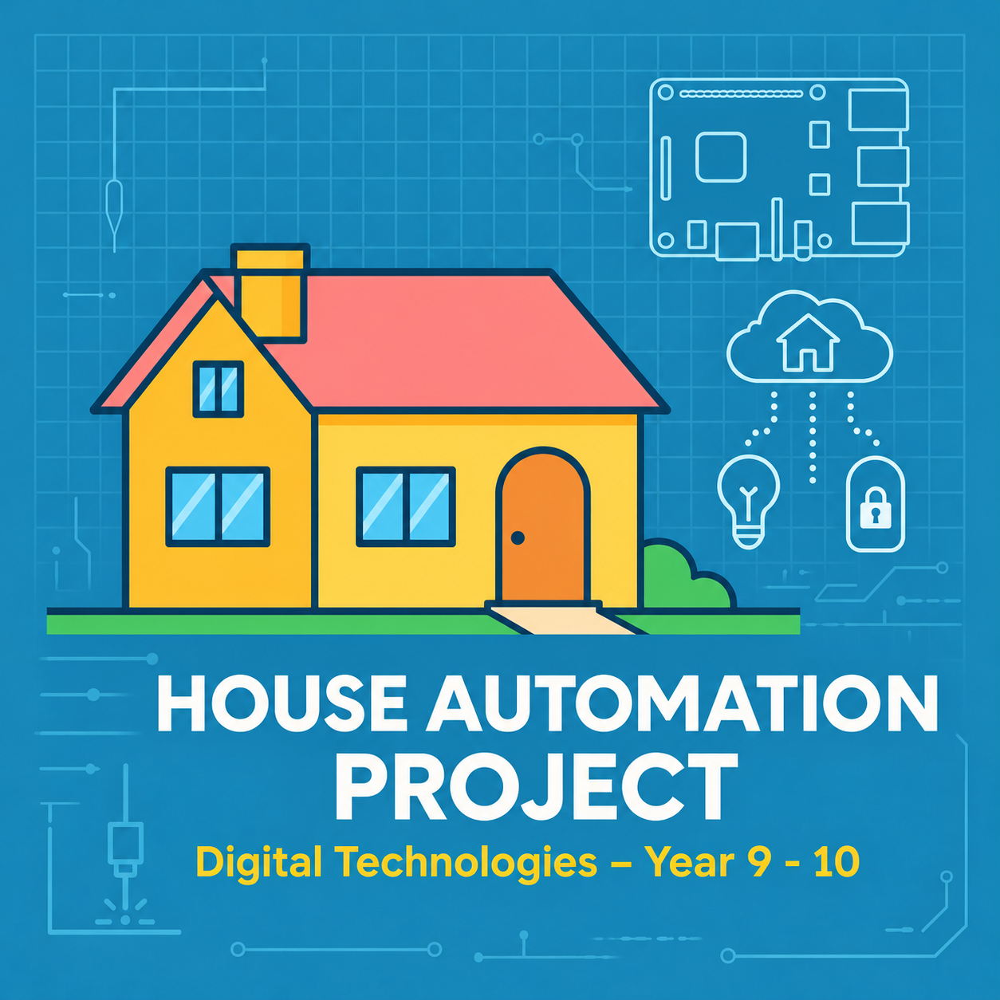
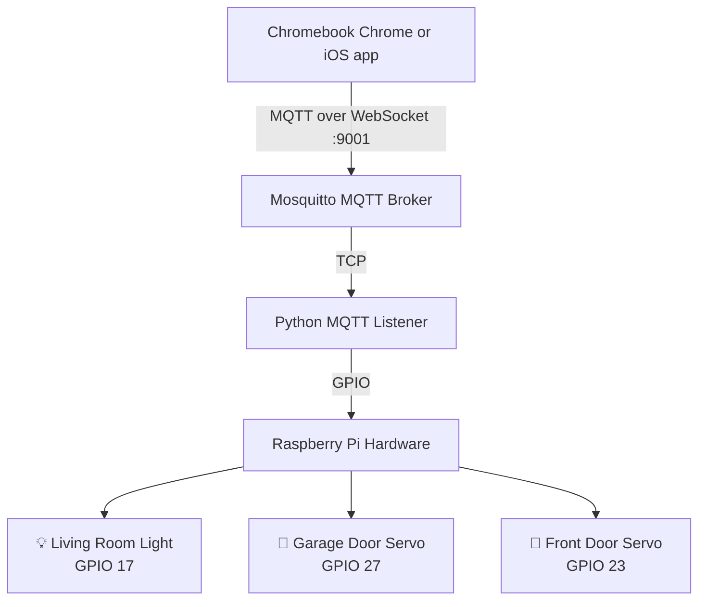

# 🏠 Simpson's House Smart Home Control

A smart home project for controlling a Raspberry Pi LED and two servo-driven doors. Students can develop a **Chromebook browser controller**, or use the existing iPad Swift Playgrounds app. Both communicate with the Pi using **MQTT over WebSocket**.

[](https://github.com/roanvtkc/simpsons-house)
[](https://mqtt.org/)
[](https://www.apple.com/swift/playgrounds/)
[](https://www.raspberrypi.org/)
[](LICENSE)

<p align="center">
  
</p>


## ✨ Features

- **🏠 Smart Home Control**: Complete home automation system inspired by The Simpsons
- **💻 Chromebook coding project**: An HTML, CSS and JavaScript starter for students to complete and customise
- **📱 iOS App**: SwiftUI interface built for Swift Playgrounds
- **🌐 MQTT over WebSocket**: Modern, reliable communication protocol
- **🔧 GPIO Control**: Direct hardware control of LEDs and servo motors
- **⚙️ Servo Control**: PWM angle control on both the garage door and the front door
- **📡 Device messaging**: Send commands and receive status through the MQTT broker
- **🕵️ mDNS Advertisement**: The Pi advertises its MQTT service; Chromebook users enter the Pi address
- **⚙️ Systemd Integration**: Professional service management

## 📚 Guides

| Guide | What it covers |
|---|---|
| [Getting the latest version](#4-getting-the-latest-version) | Updating the Pi with `git pull`, and what to do if it shows an error |
| [WIRING_GUIDE.md](WIRING_GUIDE.md) | Identifying each component, breadboard layout, per-device troubleshooting |
| [SERVO_TUNING_GUIDE.md](SERVO_TUNING_GUIDE.md) | Changing how far the doors open, reversing direction, slowing the movement |
| [EXTENSION_GUIDE.md](EXTENSION_GUIDE.md) | Adding your own circuits — the Python side and the Swift app side |
| [TEACHING_GUIDE.md](TEACHING_GUIDE.md) | Year 9–10 Chromebook coding project, curriculum links and student tasks |
| [laser-cut/README.md](laser-cut/README.md) | DXF sheets, part chart, layer settings |

## 🔥 Laser-cut plans

Ready-to-import DXF plans are available for two or ten houses on a 450 × 450 mm
bed, plus a ten-house 600 × 450 mm option. See the
[laser-cut guide](laser-cut/README.md) for the sheet files, previews, part chart,
layer settings, and verification results.

## 🏗️ System Architecture



## 📋 Prerequisites

- **Raspberry Pi** running Raspberry Pi OS (32-bit or 64-bit)
- **Terminal access** to the Pi, either directly or using SSH with an account configured on the Pi
- **Git installed** on the Pi to clone the project; see the Raspberry Pi setup steps below
- **One client option:** a Chromebook with Chrome and an approved code editor, or an iPad with Swift Playgrounds / a Mac with Xcode
- **For the Chromebook student workflow:** ChromeOS Linux development environment with Python 3, or a school-approved alternative that can edit and serve each student's files over local HTTP. A teacher can also serve a demonstration copy from the Pi.
- **Hardware components**: LEDs, resistors, two SG90 servo motors (garage door and front door), breadboard
- **Network access**: The Chromebook or iPad must be able to reach the Pi on the local network; school Wi-Fi client isolation may need to be addressed by the network administrator

## 🚀 Quick Start

### 0. Certificate Installation (Corporate Networks Only)

If you're in a corporate environment with FortiGate firewalls or other SSL inspection systems, `setup.sh` will fail at the "Upgrading pip and setuptools" step with certificate errors like:

```
ERROR: Could not find a version that satisfies the requirement setuptools (from versions: none)
ERROR: No matching distribution found for setuptools
```

with `SSLError(SSLCertVerificationError(... self-signed certificate in certificate chain))` above it in `/tmp/simpsons_house_debug.log`.

**Quick Certificate Installation:**
```bash
# Run the certificate installer from this repo
chmod +x install_ca.sh
./install_ca.sh
```

> **Note:** run the copy in this repo. A copy is also published at
> `http://10.20.1.83:8081/install_ca.sh`, but it may lag behind this one.

The installer adds the FortiGate SSL-inspection CA (`O=Fortinet`) to the system
trust store. Note that `git clone` from GitHub works *without* this — github.com
is exempt from deep inspection — so a successful clone is not evidence that the
certificate is installed. The Python package indexes (pypi.org, piwheels.org,
files.pythonhosted.org) *are* inspected, which is why `setup.sh` fails without it.

### 1. Hardware Setup

#### 🔌 GPIO Pin Layout (BCM Numbering)

```
    3V3  (1) (2)  5V
  GPIO2  (3) (4)  5V
  GPIO3  (5) (6)  GND
  GPIO4  (7) (8)  GPIO14
    GND  (9) (10) GPIO15
 GPIO17 (11) (12) GPIO18
 GPIO27 (13) (14) GND
 GPIO22 (15) (16) GPIO23
    3V3 (17) (18) GPIO24
 GPIO10 (19) (20) GND
  GPIO9 (21) (22) GPIO25
 GPIO11 (23) (24) GPIO8
    GND (25) (26) GPIO7
  GPIO0 (27) (28) GPIO1
  GPIO5 (29) (30) GND
  GPIO6 (31) (32) GPIO12
 GPIO13 (33) (34) GND
 GPIO19 (35) (36) GPIO16
 GPIO26 (37) (38) GPIO20
    GND (39) (40) GPIO21
```

#### 🔧 Wiring

> 📖 **See [WIRING_GUIDE.md](WIRING_GUIDE.md) for the full step-by-step wiring instructions**, including how to identify each component, breadboard layouts, common mistakes, and per-device troubleshooting.

Quick reference — connections at a glance:

**💡 Living Room Light (GPIO 17 → physical pin 11)**
```
Pi GPIO 17 (pin 11) ─── 220Ω resistor ─── LED (+) long leg
                                           LED (−) short leg ─── Pi GND (pin 9)
```
Key fact: the **longer LED leg is +**; it goes toward GPIO 17. The shorter leg goes to GND.

**🚗 Garage Door — Servo Motor (GPIO 27 → physical pin 13)**
```
Pi GPIO 27 (pin 13) ─── Servo SIGNAL wire (orange / yellow / white)
Pi 5V      (pin  2) ─── Servo POWER wire  (red)
Pi GND     (pin 14) ─── Servo GROUND wire (brown / black)
```
Key fact: **red is always power**; if your servo has different colours, red is still VCC.

**🚪 Front Door — Servo Motor (GPIO 23 → physical pin 16)**
```
Pi GPIO 23 (pin 16) ─── Servo SIGNAL wire (orange / yellow / white)
Pi 5V      (pin  4) ─── Servo POWER wire  (red)
Pi GND     (pin  6) ─── Servo GROUND wire (brown / black)
```
Key fact: **red is always power**; if your servo has different colours, red is still VCC.

#### 📋 Component List

| Component | Quantity | Notes |
|-----------|----------|-------|
| LED (any color) | 1 | For light indication |
| 220Ω Resistor | 1 | For LED current limiting |
| Servo Motor (SG90) | 2 | One for the garage door, one for the front door |
| Breadboard | 1 | For prototyping |
| Jumper Wires | 15+ | Male-to-female recommended |
| Breadboard Power Module | 1 | Optional, for cleaner power distribution |

#### ⚠️ Safety Notes

- **Two SG90 servos run fine on Pi 5V**: they draw little enough current that no external supply or driver board is needed
- **Never use Pi power for high-current motors**
- **Double-check connections** before powering on
- **Use appropriate resistors** to prevent LED burnout
- **Servo direction**: check which way each servo swings before gluing it into the model
- **Common Ground**: if you do add external power, its GND must be connected to Pi GND

#### 🔍 Pin Verification

Use this command to see the physical pin layout:
```bash
pinout
```

### 2. Raspberry Pi Setup

**Install Git (if needed):**

On your Raspberry Pi, if you see `git: command not found` when trying to clone:
```bash
sudo apt update
sudo apt install -y git
```

**Clone the repository:**
```bash
git clone https://github.com/roanvtkc/simpsons-house.git
cd simpsons-house
```

**Run the automated setup:**
```bash
chmod +x setup.sh
./setup.sh
```

The setup script will:
- ✅ Install all required packages (including git if missing)
- ✅ Configure MQTT with WebSocket support (ports 1883 and 9001)
- ✅ Set up Python environment and GPIO control
- ✅ Create systemd services for automatic startup
- ✅ Configure mDNS for device discovery
- ✅ Test MQTT messages in both directions between TCP and WebSocket clients; hardware still needs a separate test

### 3. Choose a control app

#### Chromebook: student coding project

The [chromebook-app](chromebook-app/) folder is a **starter project for students to complete**. The garage Close command has an intentional bug, the active-device count and some status handling are unfinished, and the front-door buttons need to be added. The supplied MQTT transport is ready to use. See the [Teaching Guide](TEACHING_GUIDE.md) for the tasks, test cases and curriculum links.

1. On the Pi, find its address and check the services:

   ```bash
   hostname -I
   sudo systemctl status mosquitto simpsons-house --no-pager
   ```

   Use the Pi's local network IP address, for example `192.168.5.123`.

2. Give each student or group **their own copy** of `chromebook-app/`. They can copy it from a teacher-provided project or download and extract this repository using **Code → Download ZIP** on GitHub. On a Chromebook with Linux enabled, copy the `chromebook-app` folder into **Linux files** using the Files app.

3. In the Chromebook Linux terminal, run the following from the Linux home folder. Install or enable Python 3 through the school's approved process if it is unavailable:

   ```bash
   cd ~
   python3 -m http.server 8000 --bind 127.0.0.1 --directory chromebook-app
   ```

   Leave the terminal open. This server serves that student's files on the Chromebook; it does not start the Pi's controller.

4. Open **http://localhost:8000** in Chrome. In **Raspberry Pi address**, enter the Pi's actual IP address from step 1. When the page is hosted locally, the address box may contain `localhost`, which points to the Chromebook and must be replaced. Click **Connect to House**.

5. Edit `index.html`, `styles.css`, and `app.js` in the student's copy, then refresh Chrome to see changes. Use the light as the working example and complete the remaining controls described in the [Teaching Guide](TEACHING_GUIDE.md). The page shows the last reported status; a sent command alone does not confirm the hardware moved.

If Linux is unavailable on managed Chromebooks, use a school-approved editor and a local HTTP server for each student's copy. A page hosted over HTTPS cannot connect to the Pi's `ws://` listener without additional secure hosting and broker configuration.

**Teacher demonstration from the Pi:** From the project folder on the Pi, run:

```bash
cd ~/simpsons-house
python3 -m http.server 8000 --bind 0.0.0.0 --directory chromebook-app
```

Leave that terminal open, then visit `http://PI_IP_ADDRESS:8000` in Chrome, substituting the Pi's address. This serves one shared copy and is suited to demonstration; student edits should be made in separate copies. It serves the same intentionally incomplete starter.

#### iPad: Swift Playgrounds app

1. Download and unzip `SimpsonsHouse.swiftpm.zip` on the iPad and open the resulting project in Swift Playgrounds.
2. Find the Pi's IP address with `hostname -I` on the Pi. In `ContentView.swift`, set the MQTT client host to that address (see [Network Settings](#network-settings)). The packaged client defaults to `192.168.5.123`.
3. Run the app and grant Local Network permission if prompted, then tap **Connect to House**.

### 4. Getting the latest version

When the project is updated on GitHub, the Pi does not change by itself. Run
these commands on the Pi to download the updates.

**1. Go to the project folder**

```bash
cd ~/simpsons-house
```

**2. Download the updates**

```bash
git pull
```

If there is nothing new, you will see:

```
Already up to date.
```

If there are updates, you will see the files that changed, for example:

```
Updating abc1234..def5678
Fast-forward
 EXTENSION_GUIDE.md | 1 +
 mqttlistener.py    | 2 +-
 2 files changed, 2 insertions(+), 1 deletion(-)
```

**3. Restart the house program** so it runs the new code:

```bash
sudo systemctl restart simpsons-house.service
```

**4. Check it is running:**

```bash
sudo systemctl status simpsons-house.service --no-pager
```

Look for `Active: active (running)` near the top. Press `q` if the output does
not return you to the prompt.

**What `git pull` does not change**

- **Your door positions.** `servo_angles.json` is kept, so you do not need to
  tune the doors again.
- **The iPad app.** `git pull` only updates the Pi. To get a new version of the
  app, download `SimpsonsHouse.swiftpm.zip` from GitHub again on the iPad.
- **Student Chromebook copies.** A `git pull` on the Pi does not update copies
  saved on Chromebooks. Keep students' customised work and distribute updates
  separately. A demonstration page served directly from the Pi uses its copy.

#### If `git pull` shows an error

**`error: Your local changes to the following files would be overwritten by merge`**

Someone has edited a project file on this Pi, usually `mqttlistener.py`. Git will
not overwrite those edits without asking. The message lists the files:

```
error: Your local changes to the following files would be overwritten by merge:
	mqttlistener.py
Please commit your changes or stash them before you merge.
Aborting
```

Nothing has been changed yet. Choose one option:

*Option A: Throw the edits away and take the update.* Use this if the edits were
from the old servo guide (changing angle numbers by hand), or you do not need
them. The edits are set aside, not deleted, so they can be recovered.

```bash
git stash
git pull
sudo systemctl restart simpsons-house.service
```

*Option B: Keep the edits and take the update.* Use this if you are an extension
student and the edits are your own code, such as a new device.

```bash
git stash
git pull
git stash pop
```

If `git stash pop` ends with `Dropped refs/stash@{0}`, your edits are back on top
of the update. Restart the house program and test it.

If it says `CONFLICT (content): Merge conflict in mqttlistener.py`, your edits and
the update changed the same lines. Your edits are still saved (it says
`The stash entry is kept in case you need it again`). Put the file back to the
updated version, then ask your teacher to help merge your code in:

```bash
git reset --hard
```

**`fatal: not a git repository`**

You are not in the project folder. Run `cd ~/simpsons-house` and try again.

**`Could not resolve host: github.com`**

The Pi is not connected to the internet. Check the Wi-Fi and try again.

## 🎮 Using the controls

On a Chromebook, enter the Pi's IP address and click **Connect to House**. The
light buttons and Activity list provide a starting point for testing. Complete
the garage, front-door and status tasks in the [Teaching Guide](TEACHING_GUIDE.md)
before expecting all controls to work. On iPad, run the Swift Playgrounds app
and tap **Connect to House**.

The Pi accepts these commands:

- **💡 Living room light:** `ON` / `OFF`
- **🚗 Garage door:** `OPEN` / `CLOSE`
- **🚪 Front door:** `ON` (open) / `OFF` (close)

To adjust how far the doors move, use the [Servo Tuning Guide](SERVO_TUNING_GUIDE.md).

## 🛠️ Configuration

### MQTT Topics
| Topic | Description | Commands |
|-------|-------------|----------|
| `home/light` | Living room light control | `ON`, `OFF` |
| `home/garage` | garage door servo (GPIO 27) | `OPEN`, `CLOSE` |
| `home/door` | Front door servo | `ON` (open), `OFF` (close) |

### Network Ports
- **1883**: MQTT TCP (standard MQTT clients)
- **9001**: MQTT over WebSocket (Chromebook and iOS clients)
- **8000**: Optional HTTP server for the Chromebook project. A server bound to `127.0.0.1` on a Chromebook serves only that device; a demonstration server on the Pi must be reachable from the Chromebook.

### Service Management
```bash
# Check status
sudo systemctl status simpsons-house
sudo systemctl status mosquitto

# View logs
sudo journalctl -u simpsons-house -f
sudo journalctl -u mosquitto -f

# Restart services
sudo systemctl restart simpsons-house
sudo systemctl restart mosquitto

# Test MQTT manually
mosquitto_pub -h localhost -t home/light -m ON
mosquitto_pub -h localhost -t home/garage -m OPEN
mosquitto_sub -h localhost -t 'home/#' -v

# Check broker traffic between MQTT TCP and WebSocket without moving hardware
cd ~/simpsons-house
mqttenv/bin/python mqtt_websocket_check.py
```

## 🔧 Advanced Configuration

### Custom GPIO Pins
Edit `mqttlistener.py` to change pin assignments:
```python
# GPIO pin assignments (BCM numbering)
LIGHT_PIN        = 17   # Light control
GARAGE_SERVO_PIN = 27   # Garage door servo signal
SERVO_PIN        = 23   # Front door servo signal
```

### Servo Angles
Set how far each door opens and closes with the calibration tool. No code editing needed:
```bash
cd ~/simpsons-house
sudo systemctl stop simpsons-house.service
mqttenv/bin/python servo_calibrate.py
```
Move a door until it looks right, type `closed` or `open` to save it, then `q` to quit and `sudo systemctl start simpsons-house.service`. Positions are saved per Pi in `servo_angles.json` (not tracked by git). Until something is saved, doors use open 90°, closed 0°.

> 📖 **See [SERVO_TUNING_GUIDE.md](SERVO_TUNING_GUIDE.md)** for step-by-step instructions, reversing a door that opens the wrong way, and slowing the movement down.

### Network Settings

**Chromebook:** Enter the Pi's IP address in the page's **Raspberry Pi address**
field. The browser connects to `ws://PI_IP_ADDRESS:9001/`. If the page is
served at `http://localhost:8000` on the Chromebook, replace `localhost` in the
field with the Pi's IP.

**iPad:** In the Swift project's `ContentView.swift`, update the MQTT client host:
```swift
@StateObject private var mqttClient = SimpsonsHouseMQTTClient(host: "YOUR_PI_IP_ADDRESS")
```

## 🧪 Testing & Verification

### Test GPIO Pins Before MQTT Setup

**Run the built-in hardware test:**
```bash
cd ~/simpsons-house
python3 gpio_test.py
```

It walks the light and both servos in turn. If you want to try a single servo by
hand, this is the minimum:
```python
#!/usr/bin/env python3
import RPi.GPIO as GPIO
import time

GARAGE_SERVO_PIN = 27          # use 23 for the front door servo

GPIO.setmode(GPIO.BCM)
GPIO.setup(GARAGE_SERVO_PIN, GPIO.OUT)
pwm = GPIO.PWM(GARAGE_SERVO_PIN, 50)   # 50 Hz is the hobby-servo standard
pwm.start(0)

try:
    for angle in (0, 90, 0):
        pwm.ChangeDutyCycle((angle / 180.0) * 10 + 2)   # 0° → 2%, 180° → 12%
        time.sleep(0.8)                                  # let the servo travel
        pwm.ChangeDutyCycle(0)                           # stop pulsing, avoid jitter
        time.sleep(0.5)
finally:
    pwm.stop()
    GPIO.cleanup()
```

### Expected Results:
- **💡 Light LED**: Should turn ON for 2 seconds, then OFF
- **🚗 Garage door servo**: Should swing from 0° (closed) to 90° (open) and back
- **🚪 Front door servo**: Should move from 0° to 90° and back to 0°

### Verify Services
```bash
# Check MQTT broker
sudo systemctl status mosquitto

# Check listening ports (should show both 1883 and 9001)
ss -tlnp | grep -E ':(1883|9001) '

# Test MQTT TCP and WebSocket in both directions without moving hardware
cd ~/simpsons-house
mqttenv/bin/python mqtt_websocket_check.py

# Check mDNS discovery
avahi-browse -rt _mqtt._tcp
```

### Test Device Control
```bash
# Test individual devices
mosquitto_pub -h localhost -t home/light -m ON
mosquitto_pub -h localhost -t home/garage -m OPEN   # Open garage door
mosquitto_pub -h localhost -t home/garage -m CLOSE  # Close garage door
mosquitto_pub -h localhost -t home/door -m ON   # Servo open
```

## 🐛 Troubleshooting

<details>
<summary><strong>Chromebook connection and coding project</strong></summary>

**The page does not load:** Check that the HTTP server is still running. Use
`http://localhost:8000` when the server runs on the Chromebook, or
`http://PI_IP_ADDRESS:8000` when it runs on the Pi. Check the folder supplied to
`--directory` exists and contains `index.html`.

**The page loads but does not connect:** Replace `localhost` in the address
field with the Pi's IP from `hostname -I`. Check `sudo systemctl status mosquitto`
on the Pi and run `mqttenv/bin/python mqtt_websocket_check.py` from the project
folder. This checks the broker locally; it does not prove the Chromebook can
reach the Pi. Ask the network administrator to check device isolation and TCP
port 9001. A Pi-hosted page also requires port 8000.

**Chrome blocks the connection:** Use the HTTP setup above. An HTTPS-hosted
page cannot use the Pi's unsecured `ws://` connection without additional
secure WebSocket configuration. The supplied anonymous broker configuration is
for a trusted classroom network.

**A command is sent but the hardware does not respond:** Check
`sudo systemctl status simpsons-house` and the Activity list. The Chromebook
starter deliberately contains a garage Close bug, missing door buttons and
unfinished status handling. Complete the tasks in the
[Teaching Guide](TEACHING_GUIDE.md), then check wiring and the Pi's service log.

</details>

<details>
<summary><strong>Servo Motor Issues</strong></summary>

**Servo doesn't move:**
- Check the signal wire is on the right pin — GPIO 27 (pin 13) for the garage, GPIO 23 (pin 16) for the front door
- Red wire must be on Pi 5V, not 3.3V — a servo on 3.3V often twitches but won't hold
- Ensure the servo GND is connected to Pi GND
- Confirm nothing else is holding the pin: `sudo fuser /dev/gpiomem`

**Servo jitters or hums when idle:**
- Expected if pulses keep being sent. The code calls `ChangeDutyCycle(0)` after each move to stop this — check it isn't commented out
- Both servos on Pi 5V can brown out the Pi if they move at the same instant under load; add an external 5V supply (GND common with the Pi) if so

**Servo moves the wrong way:**
- Re-save the open and closed positions the other way round with `servo_calibrate.py` (see [SERVO_TUNING_GUIDE.md](SERVO_TUNING_GUIDE.md))
- Or remount the horn 90° round on the spline

**Servo doesn't reach full travel:**
- SG90s vary; adjust the 2%–12% duty range in `set_servo_angle()` to suit your unit
- Check the door isn't binding on the model before blaming the servo
</details>

<details>
<summary><strong>GPIO & Hardware Issues</strong></summary>

**Check GPIO status:**
```bash
# See pin layout
pinout

# Check what's using GPIO pins
sudo fuser /dev/gpiomem
```

**Manual servo testing:**

A servo needs a continuous 50 Hz pulse train, so it cannot be driven from the
shell the way an LED can — use the Python snippet in
[Testing & Verification](#-testing--verification) above, or `gpio_test.py`.

**Common servo wiring issues:**
- Signal on the wrong pin: garage is GPIO 27 (pin 13), front door is GPIO 23 (pin 16)
- Power on 3.3V instead of 5V — always use a 5V pin for the red wire
- Missing common ground between servo and Pi
- Connector reversed: check the wire colours, not the plug orientation — red is always power
</details>

### Log Locations
- **Setup logs**: `/tmp/simpsons_house_setup.log`
- **MQTT listener**: `sudo journalctl -u simpsons-house -f`
- **Mosquitto broker**: `/var/log/mosquitto/mosquitto.log`
- **System logs**: `sudo journalctl -f`

## 🔒 Security Considerations

> ⚠️ **Important**: This project uses `allow_anonymous true` for simplicity. For production use:

- Enable MQTT authentication with username/password
- Use TLS/SSL encryption for MQTT connections
- Configure firewall rules to limit access
- Regular security updates for all components
- Consider VPN access for remote control

## 📁 Project Structure

```
simpsons-house/
├── 📄 README.md                    # This file
├── 📖 TEACHING_GUIDE.md            # Chromebook coding tasks and curriculum links
├── 📖 WIRING_GUIDE.md              # Wiring and component guidance
├── 📖 SERVO_TUNING_GUIDE.md         # Adjusting door angles, direction and speed
├── 📖 EXTENSION_GUIDE.md            # Adding your own circuits (Python + Swift)
├── 🔧 setup.sh                     # Automated setup script
├── 🧪 mqtt_websocket_check.py      # TCP / WebSocket broker connection check
├── 🐍 mqttlistener.py               # Python MQTT listener with servo control
├── 🔐 install_ca.sh                # FortiGate certificate installer
├── 🧪 gpio_test.py                  # Hardware test: light + both servos
├── 🎛️  servo_calibrate.py            # Set and save each door's open/closed angles
├── 📁 chromebook-app/              # Student browser coding starter
│   ├── index.html                  # Page structure and missing door controls
│   ├── styles.css                  # Student-customisable appearance
│   ├── app.js                      # Student coding and debugging tasks
│   ├── house-transport.js          # Supplied MQTT over WebSocket transport
│   ├── python_bridge.py            # Optional Python translation exercise
│   └── test_python_bridge.py       # Tests for the Python exercise
├── 📁 extensions/                   # Optional extension hardware
│   └── 🧪 stepper_test.py           # Stepper motor test (extension only)
├── 📱 SimpsonsHouse.swiftpm.zip   # Swift Playgrounds project
└── 📁 laser-cut/                   # Cutting plans and assembly resources
```

## 🤝 Contributing

We welcome contributions! Discuss proposed changes in a [GitHub issue](https://github.com/roanvtkc/simpsons-house/issues).

### Development Setup
1. **Fork the repository**
2. **Create a feature branch**: `git checkout -b feature/amazing-feature`
3. **Commit changes**: `git commit -m 'Add amazing feature'`
4. **Push to branch**: `git push origin feature/amazing-feature`
5. **Open a Pull Request**

## 📄 License

This project is licensed under the MIT License - see the [LICENSE](LICENSE) file for details.

## 🎯 Roadmap

### Upcoming Features
- [ ] **Temperature sensors** and climate control
- [ ] **Motion detection** and security features
- [ ] **Voice control** integration (Siri Shortcuts)

> **Motors are extension work, not core.** DC motors, steppers, speed control and
> direction reversal all need external power and a driver board, so they sit
> outside the base build. See [EXTENSION_GUIDE.md](EXTENSION_GUIDE.md).

### Version History
- **v3.3** - Garage door moved from a 28BYJ-48 stepper + ULN2003 to an SG90 servo on GPIO 27
- **v3.1** - ULN2003 motor driver integration, improved motor control
- **v3.0** - MQTT over WebSocket support, systemd integration
- **v2.0** - Basic MQTT control with GPIO
- **v1.0** - Initial HTTP-based control system

## 📞 Support

### Getting Help
- 📖 Check the [Teaching Guide](TEACHING_GUIDE.md) and the [troubleshooting section](#-troubleshooting)
- 🐛 [Report Issues](https://github.com/roanvtkc/simpsons-house/issues)
- 💬 [Discussions](https://github.com/roanvtkc/simpsons-house/discussions)

### Community
- 🌟 **Star this repo** if you find it useful!
- 🐦 Follow updates on Twitter: [@SimpsonsHousePi](https://twitter.com/simpsonshousepi)
- 💡 Share your builds and modifications

---

**Made with ❤️ for smart home enthusiasts and Simpsons fans**

For support and questions, please [open an issue](https://github.com/roanvtkc/simpsons-house/issues) or check the [troubleshooting section](#-troubleshooting).
